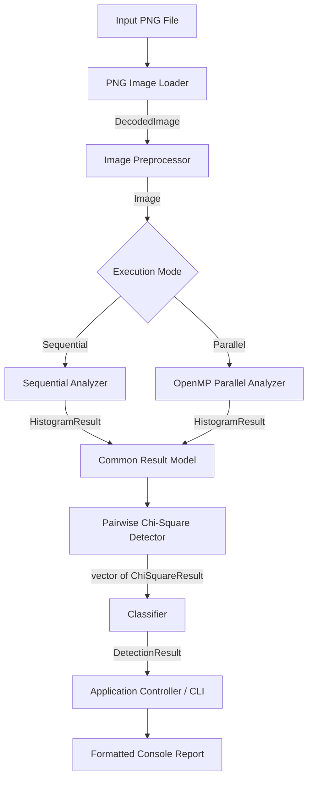
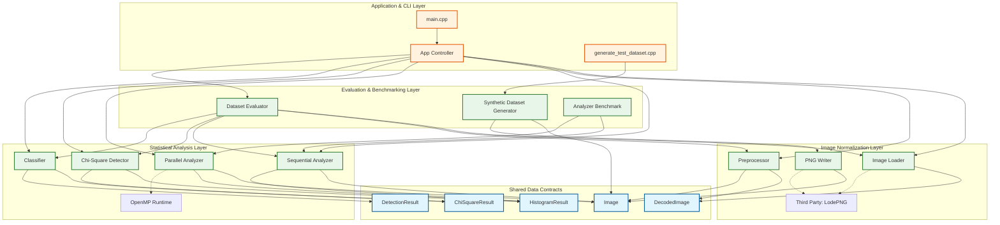

# Stegoscan Architecture Specification

## 1. Executive Summary

`stegoscan` is a specialized, high-performance command-line steganalysis system designed to inspect 8-bit PNG images for statistical signatures of Least Significant Bit (LSB) replacement steganography.

The primary academic goal is to demonstrate **correct parallel work distribution and race-free aggregation** using OpenMP, comparing its efficiency and scalability against an equivalent sequential implementation while maintaining bit-identical results.

---

## 2. Architectural Principles

1. **Strict Decoupling via Immutable Contracts:**
   - Image decoding, preprocessing, histogram construction, statistical detection, and classification are isolated into dedicated modules.
   - The statistical detector and classifier are agnostic to how histograms are produced (sequential vs. OpenMP parallel).
2. **Deterministic Histogram Construction:**
   - Both sequential and parallel analyzers consume the canonical `Image` type and output the identical `HistogramResult` model.
   - OpenMP parallelism is confined strictly to row-level histogram accumulation; it is never used for decoding or classification.
3. **Data-Race-Free Parallel Design:**
   - Threads operate strictly on thread-local histograms and private diagnostic bookkeeping structures.
   - Post-loop reduction merges thread-local bins without atomic locks or critical sections in the hot loop.
4. **Independent Testability:**
   - Every module can be compiled and unit-tested in isolation without requiring the complete pipeline or filesystem dependencies.

---

## 3. High-Level Data Flow



---

## 4. Module Responsibilities

| Module | Core Responsibility | Input | Output | Non-Goals / Exclusions |
|---|---|---|---|---|
| **Image Data Types** (`image/image.h`, `decoded_image.h`) | Invariant-enforced representations for raw and normalized images | Raw fields / buffer | Validated structs | No decoding or file I/O |
| **PNG Loader** (`image/image_loader.h`) | Decodes 8-bit PNG files; validates signature, bit depth, and formats | File path | `DecodedImage` | No steganalysis; rejects 16-bit and sub-8-bit PNGs |
| **PNG Writer** (`image/png_writer.h`) | Encodes normalized grayscale/RGB images to 8-bit PNG | Path, `Image` | PNG on disk | No color conversion or alpha injection |
| **Image Preprocessor** (`image/preprocessor.h`) | Normalizes decoded buffers into 1-channel or 3-channel representations | `DecodedImage` | `Image` | Discards alpha; does not modify color samples |
| **Histogram Model** (`analysis/histogram.h`) | Shared result contract and equality verification | Histogram data | `HistogramResult` | No statistical hypothesis testing |
| **Sequential Analyzer** (`analysis/sequential_analyzer.h`) | Single-threaded ground truth histogram generation | `Image` | `HistogramResult` | Strictly serial (no OpenMP) |
| **Parallel Analyzer** (`analysis/parallel_analyzer.h`) | Multi-threaded OpenMP row-distributed histogram generation | `Image`, threads | `HistogramResult` | Race-free; private histograms merged post-loop |
| **Chi-Square Detector** (`analysis/chi_square.h`) | Pairwise chi-square evaluation of adjacent bins (PoVs) | `HistogramResult` | `vector<ChiSquareResult>` | Agnostic to analyzer source; no classification decision |
| **Classifier** (`detection/classifier.h`) | Cautious hypothesis assessment using decision threshold | Channel results | `DetectionResult` | Does not assert clean status; provides conservative label |
| **Synthetic Dataset Generator** (`evaluation/synthetic_dataset_generator.h`) | Deterministic creation of synthetic covers and LSB-stego copies | Generation config | PNG files + CSV | Strictly deterministic; no OpenMP |
| **Evaluation & Benchmarking** (`evaluation/evaluation.h`) | Confusion matrix evaluation on manifests and analyzer timing benchmarks | Manifest / `Image` | Metrics report / Benchmark report | Excludes I/O from analyzer timing |
| **Application Controller** (`app/app_controller.h`) | CLI argument parsing, workflow dispatch, and output formatting | `argc`, `argv` | Process exit code | No inline business logic or pixel algorithms |

---

## 5. Module Dependency Graph



---

## 6. OpenMP Parallelization Architecture

The parallel histogram analyzer implements a **fork-join pattern** with thread-private aggregation:

```text
Image Rows: 0 ..................................................... H-1
              │                  │                  │
    [ Thread 0 ]       [ Thread 1 ]       [ Thread 2 ]       [ Thread 3 ]
    schedule(static)   schedule(static)   schedule(static)   schedule(static)
              │                  │                  │
       Local Hist 0       Local Hist 1       Local Hist 2       Local Hist 3
              └──────────────────┴──────────────────┴─────────────────┘
                                         │
                               [ Post-Join Merge ]
                                         │
                               Final HistogramResult
```

### Key Technical Properties:
- **No Per-Pixel Synchronization:** Threads never increment shared bins, eliminating bus locking and thread contention.
- **Cache Friendly:** Each thread maintains its own array of 256 `uint64_t` bins per channel (3 KB for RGB), which resides comfortably in L1 data cache.
- **Accurate Work Diagnostics:** Each thread records its assigned row range and processed count in a dedicated pre-allocated slot indexed by `omp_get_thread_num()`.
